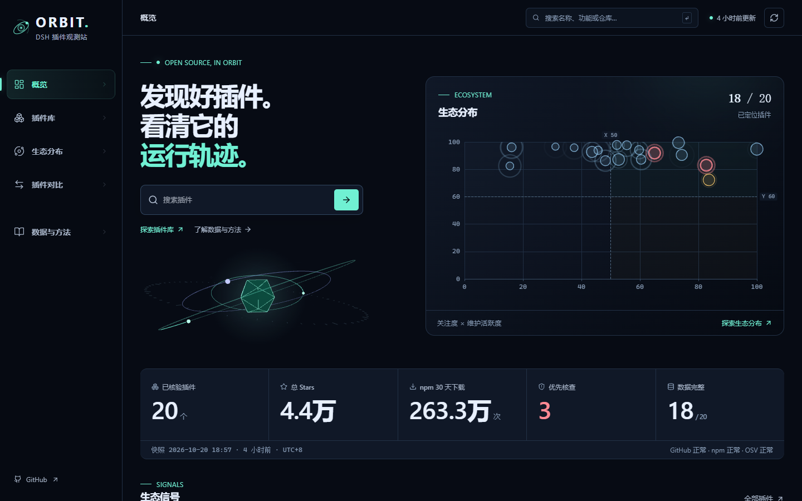
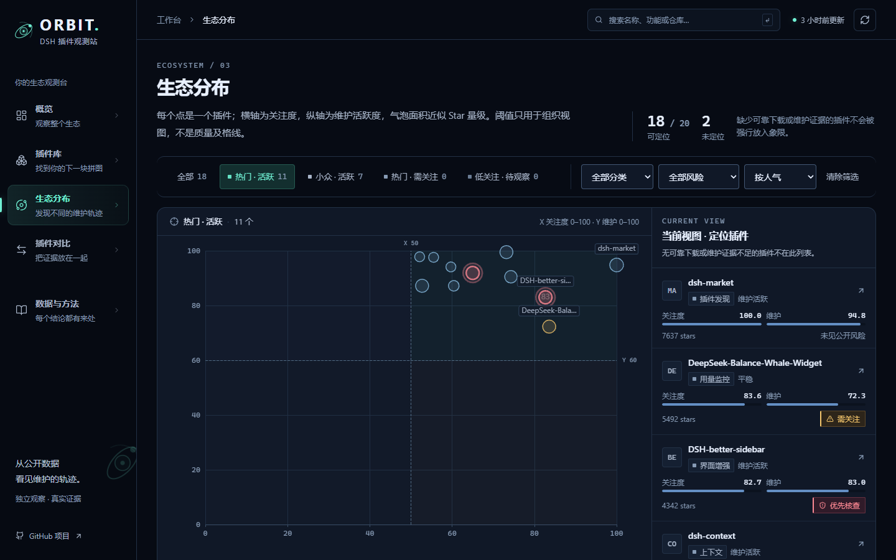
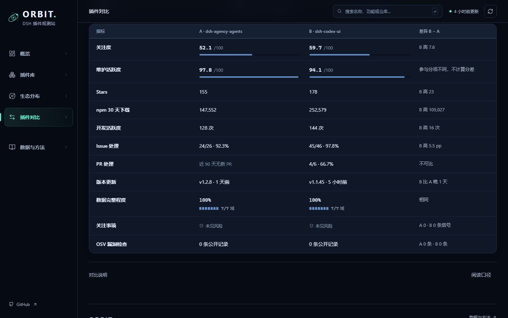
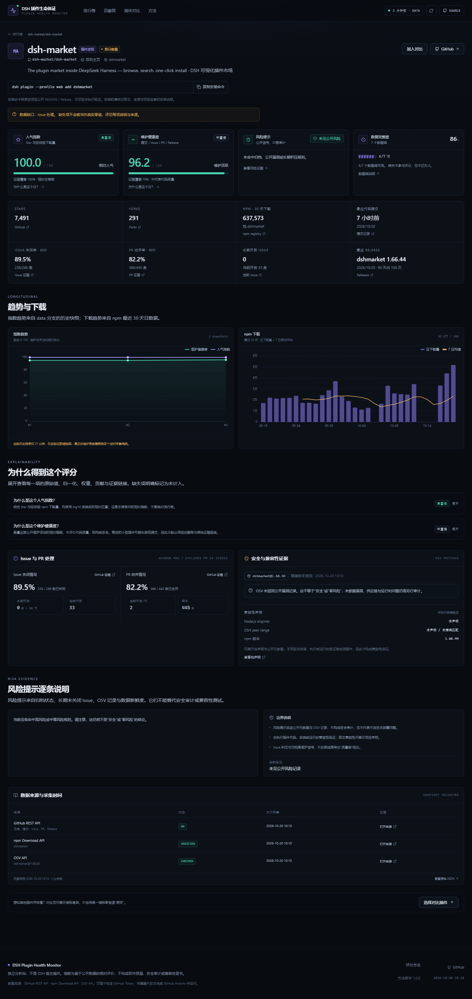
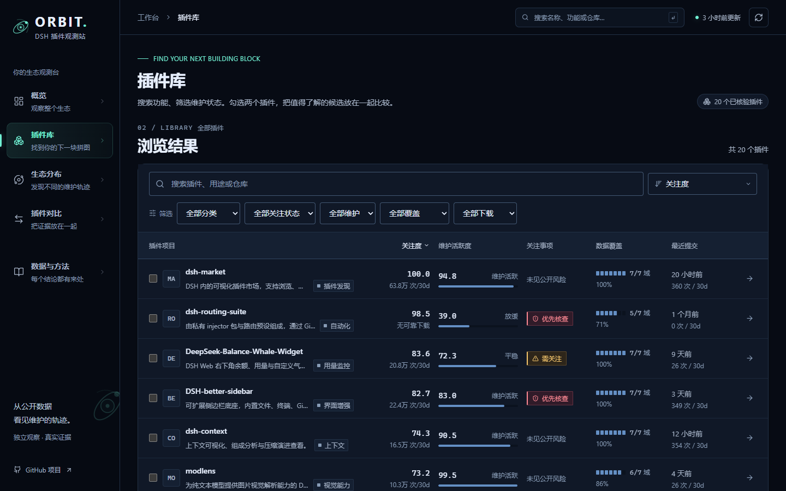

# ORBIT · DSH 插件观测站

**用真实 GitHub、npm 与 OSV 数据观察 DeepSeek Harness 插件生态。**

一个独立 Web 数据分析站，面向 DSH 插件使用者、程序员与计算机专业学生。它不是 DSH 宿主插件，而是对公开插件生态进行数据采集、信息检索、指标计算与可视化的本科《信息检索》课程项目。

- 真实数据：20 个经人工核验的 DSH 插件仓库
- 四个独立维度：关注度、维护活跃度、关注事项、数据完整度
- 导航：概览、插件库、生态分布、插件对比、数据与方法；插件详情从内容进入
- 自动化：GitHub Actions 每 6 小时采集，独立 `data` 分支保留历史，构建并部署 GitHub Pages
- 缺失数据不当 0：无法核验时明确显示原因，而不是伪精确评分



| 生态分布与详情 | 插件库与对比 |
|---|---|
|  |  |
|  |  |

> 界面截图来自本仓库真实快照。当前本地改造没有推送；使用和验收说明见 [ORBIT 交付说明](docs/ORBIT-DELIVERY.md)，评分评估见 [修订规范](docs/SCORING-REVIEW.md)。

## 快速开始

要求 Node.js **≥ 22.19**（推荐 24）与 npm。

```bash
npm install
npm run data:pull   # 从 data 分支拉取最新真实快照
npm run dev         # http://127.0.0.1:5173
```

如果远端还没有 `data` 分支，或你需要重新采集：

```bash
# 方式一：环境变量（推荐细粒度只读或采集用 Token）
export GITHUB_TOKEN=...

# 方式二：显式允许采集器读取本机 `gh auth token`
npm run collect -- --gh-cli-token

npm run dev
```

Windows PowerShell 示例：

```powershell
$env:GITHUB_TOKEN = "github_pat_..."
npm.cmd run collect
npm.cmd run dev
```

采集结果写入 `public/data/`，该目录被 `.gitignore` 排除；正式数据历史保存在独立的 `data` 分支。

### 常用命令

| 命令 | 作用 |
|---|---|
| `npm run dev` | 启动本地 Vite 开发服务器 |
| `npm run build` | 校验数据、构建生产静态站、生成 `404.html` |
| `npm run preview` | 预览生产构建 |
| `npm run collect` | 采集 GitHub / npm / OSV 并写出快照 |
| `npm run data:pull` | 从远端 `data` 分支拉取快照到 `public/data` |
| `npm run typecheck` | TypeScript 全量类型检查 |
| `npm test` | Vitest 单元测试（评分、筛选、HTTP、快照） |
| `npm run test:e2e` | Playwright 浏览器验收测试 |
| `npm run assess:model` | 重建真实快照评分评估报告 |
| `npm run check:dist` | 扫描生产构建中的 Token 形态 |

## 页面与功能

### 概览 /
品牌首屏、快捷检索、真实二维生态图、关键统计、社区关注与持续维护榜单、关注事项和近期变化。桌面有延迟加载的轻量 3D 轨道装置；移动端、减少动态效果与 WebGL 失败时保留静态 SVG。

### 插件库 /plugins
名称、功能、描述、仓库与分类搜索；维护、关注状态、完整度、下载可用性筛选；排序与分页保存在网址。勾选最多两个候选，从浮动入口开始对比。桌面表格、手机卡片，筛选不跳回页首。

### 生态分布 /ecosystem
关注度 × 维护活跃度，固定 0–100 轴。图与列表联动，选择插件后读取摘要、进入详情。筛选状态写入 URL，未定位插件列出原因；旧 /quadrant 与旧首页检索链接保留参数跳转。

### 插件详情 /plugins/:id
先说明用途、维护活动与需要核查的事项，再展示原始指标、趋势和可展开的评分依据。关注事项分为维护提醒、公开漏洞与数据缺口；保留来源、时间、安装命令复制和数据缺失说明。

### 插件对比 /compare
选择、交换两个不同插件。原始指标对齐展示，桌面矩阵表头吸顶；缺失不补零。方法版本、参与分项、有效权重或采集时间不同，不计算评分差值，并解释原因。

### 数据与方法 /method
用目录、简短摘要和展开内容说明来源、公式、权重、窗口、更新策略与局限。核心数据不可用时方法页仍能阅读。

## 技术架构

```text
config/plugins.json
        │
        ├──→ scripts/collect.ts
        │       ├── GitHub REST API：分页 / 超时 / 重试 / 限额错误
        │       ├── npm registry + downloads API：repository 字段核验
        │       └── OSV API：精确 npm 包 + latest 版本
        │
        ├──→ scripts/lib/clean.ts + src/lib/contracts.ts（清洗 / 契约校验）
        │
        ├──→ src/lib/scoring.ts（关注度 / 维护活动 / 关注事项 / 完整度）
        │
        ├──→ data 分支：latest.json + history.json + status.json + snapshots/
        │
        └──→ public/data → Vite 构建 → GitHub Pages
```

- **前端**：React 18 + TypeScript + Vite 6 + Tailwind CSS 3 + Apache ECharts + Lucide Icons + Three.js + Zod
- **采集**：Node.js 24 + TypeScript + tsx
- **数据**：结构化 JSON；源码在 `main`，历史在 `data` 分支
- **部署**：GitHub Actions → GitHub Pages（`VITE_BASE=/<repo>/`）
- **测试**：Vitest + Playwright

### 目录

```text
config/        已核验插件清单
docs/          数据口径、评分规则、截图
scripts/       采集、评分辅助、数据准备、构建检查
src/           React 前端、类型、评分模块、图表
tests/unit/    评分、筛选、HTTP、快照单元测试
tests/e2e/     Playwright 浏览器验收
.github/       CI、部署、定时更新工作流
```

## 数据采集口径

详细字段、端点与统计窗口见 [docs/DATA_SOURCES.md](docs/DATA_SOURCES.md)。

- **插件发现**：不以名称含 DSH 作为判定依据；必须核验为可安装的 DSH Web 插件。
- **最近代码提交**：使用 commits 中非合并提交的 `committer.date`，不用仓库 `updated_at` / `pushed_at`。
- **近 30 天提交**：只统计非合并提交；分页达到上限时按已取得的下限计分。
- **Issue 与 PR**：Issues API 中包含 PR，统计时通过 `pull_request` 字段排除；两者分页预算独立，最多 20 页，截断时页面标注“下限样本”。
- **Issue / PR 窗口**：近 90 天创建；同时显示分母与样本量，小样本降权并提示。
- **npm 下载**：只有 registry 的 `repository` 字段与 GitHub 仓库一致时才采信；不把 Star / Fork / Release 下载冒充 npm 下载。7 日/前 7 日窗口按日期对齐，遇到平台性缺数日时显示“不可用”，不把缺口当真实 0。
- **OSV**：只有 npm 包名与精确版本匹配时才认为检查完成；空结果显示“未发现公开记录”，不显示“安全”。
- **容错**：分页上限、404、PR 功能禁用、超时、429、5xx 均有明确降级路径；所有 GitHub 仓库失败时保留上一次成功快照。

## 评分和关注规则

当前公式仍为 **1.1.0**，详见 [SCORING.md](docs/SCORING.md)。[评分评估](docs/SCORING-REVIEW.md) 包含真实样本、边界案例、权重 ±20% 扰动与样本增删，修订公式安排在后续独立步骤。[数据质量说明](docs/DATA-QUALITY.md) 记录已实现的清洗契约。

- **关注度**：`log10(1+x)` 后 min-max 归一化；Stars 45% + npm 下载 55%；缺下载时仅用 Star，评分依据覆盖降为 45%、依据等级为一般。
- **维护**：最近提交 30%、近 30 天非合并提交 15%、Issue 关闭率 20%、开放 Issue 积压 10%（`openNow/opened90d`）、PR 合并率 15%、稳定 Release 10%；缺失分项重新归一化，覆盖 < 45% 时输出“信息不足”。
- **风险**：归档、长期开放 Issue、开放 Issue 积压、OSV 公开记录、数据缺口；风险信息不完整时不标“低风险”。
- **数据完整度**：7 个数据域中的可用比例，不是插件质量。
- 生态分布只纳入同时具备维护分与经核验下载量的插件。

## 自动更新与部署

工作流：

- `.github/workflows/ci.yml`：TypeScript、Vitest、生产构建、Token 扫描、Playwright
- `.github/workflows/deploy.yml`：`main` 更新后先跑 TypeScript/单测，再从 `data` 分支取数据构建并部署 Pages
- `.github/workflows/update-data.yml`：每 6 小时或手动采集，构建校验成功后才提交 `data` 分支并部署 Pages

数据隔离原则：

1. 源码与用户修改留在 `main`；自动生成的 JSON 只提交到 `data` 分支。
2. 采集器只在 GitHub Actions 或本地运行，GitHub Token 不进入 Vite 构建。
3. 采集全部 GitHub 失败时只更新 `status.json`，不覆盖 `latest.json` / `history.json`。
4. 历史保留 90 天、单插件最多 400 个点，完整快照最多 120 份。
5. 往 `data` 分支提交不会触发 `main` 部署，避免工作流循环。
6. `update-data.yml` 将采集（只读 Token）与写数据（不安装依赖）拆成独立 job；`persist` 等构建校验成功后才推送；`deploy.yml` 和 `update-data.yml` 使用最小权限与 `concurrency` 互斥部署。
7. 官方 Actions 固定到 commit SHA，并由 Dependabot 跟踪更新。

### 首次部署

1. 仓库 Settings → Pages → Source 选择 **GitHub Actions**。
2. 确保存在 `data` 分支（本仓库已包含初始快照）。
3. 合并 PR 后 `deploy.yml` 会自动运行，或在 Actions 手动运行。
4. 项目站地址：`https://albert404s.github.io/dsh-plugin-health-monitor/`（Pages 已启用，合并后由工作流发布）。

## 测试结果

截至 2026-10-20，基于 18:57（UTC+8）的 20 个插件真实快照：

- TypeScript 检查通过；7 个文件、**66 个单元测试**通过。
- Chromium **27 个浏览器测试**通过，包含筛选/分页/返回/刷新、旧链接、双选对比、坏数据隔离、局部历史降级及 WebGL 正常与失败路径。
- 生产构建与产物检查通过；当前预览无控制台错误。
- 390、768、1024、1366×768、1440×900、1920×1080 检查无页面横向溢出。
- 必要 JS/CSS gzip 为 **约 345 KB**；独立 3D 为 136,283 字节，低于必要首屏 450 KB 目标。
- 同一快照重放评分不一致记录为 0。当前未运行新一轮完整真实 API 采集；采集衔接由模拟 API、存储回退测试和真实快照重放验证。
- 当前仅本地分支和提交；没有推送、PR 或团队主分支合并。

截图位于 docs/screenshots/；本机完整验收记录还保存在项目父目录“ORBIT-验收”。

## 局限

**这不是软件质量评估，也不是安全审计。** 它不查看源码质量、测试覆盖率、用户体验或运行时漏洞；不安装、不执行被检测插件。详细边界见 [docs/SCORING.md](docs/SCORING.md#6-已知局限)。

## 贡献插件

编辑 `config/plugins.json`，补充：

```json
{
  "id": "owner-repo",
  "repo": "owner/repo",
  "npm": "@scope/package-or-null",
  "category": "interface",
  "installCommand": "dsh plugin --profile web add ...",
  "note": "核验依据"
}
```

提交前请确认：仓库公开可访问、确实是 DSH 插件、npm 映射可在 registry 中核对；无法核验 npm 时使用 `null`，不要猜测包名。

## License

[MIT](LICENSE)
